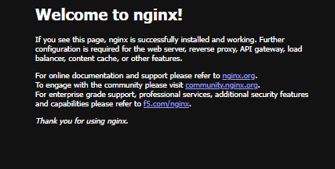
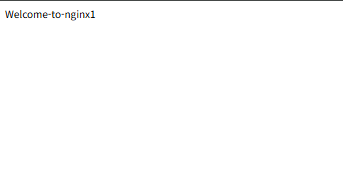
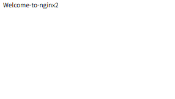
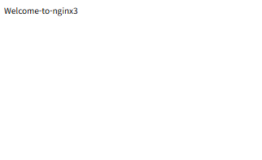

# 5주차: Docker 실행 환경 확인 및 nginx 실행

연결할 작업: https://github.com/hengky1518/devops/issues/1

## 목표와 핵심 개념

Docker 설치와 엔진 연결을 확인하고 nginx 컨테이너의 실행·접속·정리를 기록한다. 이미지는 실행 환경의 원본이고, 컨테이너는 이미지로부터 만든 실행 단위이다. `-p 8080:80`은 호스트 8080 포트를 컨테이너 80 포트에 연결한다.

## 이 세션에서 확인한 실제 결과

2026-10-21 사용자가 PowerShell에서 실행하고 채팅에 제공한 `docker version` 결과에서 클라이언트와 서버 정보가 모두 출력되었다. 사용자 터미널에서는 Docker 엔진 연결이 정상이다. Codex 세션의 엔진 접근은 권한 제한으로 실패했다. hello-world와 nginx 실행 결과는 아직 제공되지 않아 미확인이다.

| 항목 | 실제 출력 |
| --- | --- |
| Client / Engine 버전 | 29.8.1 / 29.8.1 |
| API 버전 | 1.56 |
| Docker Desktop | 4.93.0 (240920) |
| Client OS/Arch | windows/amd64 |
| Server OS/Arch | linux/amd64 |
| Context | desktop-linux |

근거: 사용자가 제공한 PowerShell 출력. Codex에서 직접 실행해 확인한 성공 결과는 아니다.

## 엔진 연결 후 실행할 명령

아래는 Ubuntu/WSL용이다. `web` 또는 `nginx1`~`nginx3` 이름과 8080·8091~8093 포트가 사용 중이면 기존 작업을 확인한 후 이름이나 포트를 변경한다. 기존 컨테이너를 임의로 삭제하지 않는다.

```bash
docker version
docker run --rm hello-world
docker run -d -p 8080:80 --name web nginx
curl -I http://localhost:8080
docker ps
```

위 명령의 실제 출력과 localhost:8080 화면을 저장한다.

## 혼자서 해보기

```bash
docker run -d -p 8091:80 --name nginx1 nginx
docker run -d -p 8092:80 --name nginx2 nginx
docker run -d -p 8093:80 --name nginx3 nginx
docker exec nginx1 sh -c 'echo "Welcome to nginx1" > /usr/share/nginx/html/index.html'
docker exec nginx2 sh -c 'echo "Welcome to nginx2" > /usr/share/nginx/html/index.html'
docker exec nginx3 sh -c 'echo "Welcome to nginx3" > /usr/share/nginx/html/index.html'
curl http://localhost:8091
curl http://localhost:8092
curl http://localhost:8093
docker ps
```

브라우저 화면 3개와 `docker ps` 화면을 `images/`에 저장하고 이 문서에서 연결한다. 이 실습에서 자신이 생성한 컨테이너임을 확인한 뒤 정리한다.

```bash
docker stop web nginx1 nginx2 nginx3
docker rm web nginx1 nginx2 nginx3
```

## 실제 수행 기록

- hello-world 실행: 사용자가 PowerShell에서 `docker run --rm hello-world`를 실행한 뒤 성공했다고 확인했다. 전체 출력과 캡처는 아직 첨부하지 않았다.
- nginx 접속·컨테이너 상태: 사용자 PowerShell 출력에서 `docker start web` 성공, `curl.exe -I http://localhost:8080`의 `HTTP/1.1 200 OK`, `Server: nginx/1.31.6` 확인. `docker ps`에서 컨테이너 `1bef6616da10`의 상태 `Up 6 seconds`, 이름 `web`, 포트 `8080->80/tcp` 확인. 응답 Date는 2026-10-21 06:48:52 GMT(한국 시간 15:48:52)이다.


- nginx1~3의 서로 다른 응답과 캡처: 사용자가 제공한 PowerShell 출력에서 아래 응답 및 실행 상태를 확인했다. 화면 캡처에는 각 컨테이너를 구별하는 문구가 표시되어 있다. 주소창은 포함되지 않아 포트 매핑은 터미널 출력으로 확인한다.

| 이름 | 컨테이너 ID | 호스트 포트 | curl 응답 | 확인 당시 상태 |
| --- | --- | --- | --- | --- |
| nginx1 | f0e3e1aa6ae9 | 8091 | Welcome-to-nginx1 | Up 36 seconds |
| nginx2 | f398a697ae0b | 8092 | Welcome-to-nginx2 | Up 29 seconds |
| nginx3 | 90a1bc986aa6 | 8093 | Welcome-to-nginx3 | Up 25 seconds |

```text
PS> curl.exe http://localhost:8091
Welcome-to-nginx1
PS> curl.exe http://localhost:8092
Welcome-to-nginx2
PS> curl.exe http://localhost:8093
Welcome-to-nginx3
```





세 컨테이너는 각각 호스트 8091·8092·8093에서 컨테이너의 80 포트로 연결된다. 같은 nginx 이미지로 실행했지만 각 컨테이너 안의 index.html을 변경해 서로 다른 문구를 응답하게 했다.
- 정리 결과: 사용자 출력에서 `docker stop nginx1 nginx2 nginx3` 및 `docker rm nginx1 nginx2 nginx3` 모두 세 이름을 반환했다. 이후 `docker ps -a`에 nginx1~3이 없어 삭제 완료를 확인했다. 기존 `custom`, `gbv2`는 중지 상태로 보존했고, 기존 `web`은 실행 상태로 유지했다. 따라서 교안의 전체 컨테이너 정리 조건 중 `web` 정리는 아직 하지 않았다.
- 오류 원인·해결 과정: `docker run -d --name web -p 8080:80 nginx` 실행 시 기존 `web` 이름과 충돌했다. 처음에는 localhost:8080 접속도 실패했다. `docker ps -a`와 `docker inspect`로 기존 컨테이너가 nginx, `8080:80`, `Exited (255)` 상태임을 확인했다. 기존 컨테이너를 삭제하지 않고 `docker start web`으로 시작해 HTTP 200 응답과 브라우저 화면을 확인했다. 이는 새 컨테이너 생성 성공이 아니라 기존 컨테이너 재사용 결과이다. 과거 종료 코드 255의 원인은 이번 확인만으로 판단하지 않았다.
- 내 말로 설명한 이미지·컨테이너·포트의 관계: [직접 작성]

## Issue에서 Merge까지

완료한 항목만 Issue #1에서 체크한다. 새 브랜치에 결과를 커밋·푸시하고, PR 본문에 `Closes #1`과 실제 검증 결과를 적는다. main에 Merge한 뒤 Issue가 닫혔는지 확인한다.

- 브랜치: [생성 후 기록]
- 커밋·PR 링크: [생성 후 기록]
- Merge 결과: [완료 후 기록]

참고: 교안 05, 20쪽·56~66쪽.
