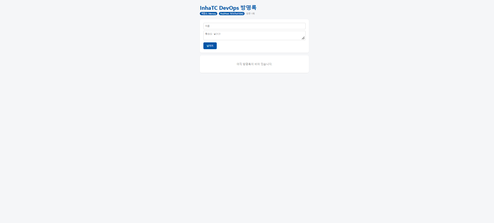
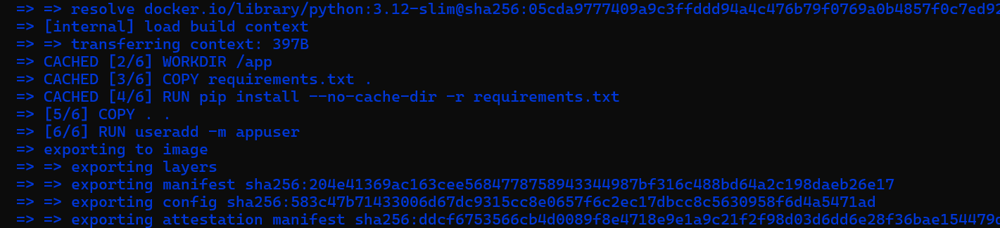

# 6주차 - Dockerfile

## 1. 내 이미지 주소

- v1: `ghcr.io/hengky1518/guestbook:v1`
- v2: `ghcr.io/hengky1518/guestbook:v2`

## 2. 다른 사용자의 이미지 실행 결과

다른 사용자가 배포한 `inhatc-devops-guestbook:v1` 이미지를 받아 내 컴퓨터에서 컨테이너로 실행하였다.



## 3. Dockerfile 각 줄 설명

- `FROM`: 이미지를 만들 때 기반으로 사용할 이미지를 지정한다.
- `WORKDIR`: 컨테이너 내부에서 작업할 디렉터리를 지정한다.
- `COPY`: 빌드 컨텍스트의 파일을 이미지 내부로 복사한다.
- `RUN`: 이미지를 빌드하는 과정에서 필요한 명령을 실행한다.
- `ENV`: 이미지에서 사용할 환경 변수의 기본값을 설정한다.
- `EXPOSE`: 컨테이너에서 사용할 포트 번호를 명시한다. 호스트에 포트를 공개하는 기능은 아니며, 외부 접속에는 `-p` 등의 설정이 필요하다.
- `CMD`: 컨테이너가 시작될 때 실행할 기본 명령을 지정한다.
- `USER`: 이후 명령과 컨테이너 프로세스를 실행할 사용자를 지정한다. 이 앱은 `appuser`를 사용한다.

## 4. 빌드 캐시 확인

Dockerfile과 파일을 변경하지 않고 다시 빌드하자 이전에 만들어 둔 레이어에 `CACHED`가 표시되었다.

변경되지 않은 단계는 다시 실행하지 않고 기존 결과를 사용하기 때문에 재빌드 시간을 줄일 수 있다. 현재 Dockerfile은 requirements.txt 복사와 패키지 설치를 앱 파일 복사보다 앞에 배치한다. 앱 코드만 바뀌고 의존성이 같다면 패키지 설치 단계의 캐시를 활용할 수 있다.



## 5. 설정을 넣는 세 가지 방법

### app.py 기본값

프로그램 코드에 작성된 기본값이다. 코드의 기본값을 바꾼 이미지를 배포하려면 코드를 수정하고 다시 빌드한다.

### Dockerfile ENV

이미지에 환경 변수의 기본값을 저장한다. 이미지 자체의 기본값을 바꾸려면 Dockerfile을 수정하고 다시 빌드한다. 실행할 때 환경 변수를 전달해 덮어쓸 수도 있다.

### docker run -e

컨테이너를 실행할 때 환경 변수를 전달한다. 이미지를 다시 빌드하지 않고 실행 시 설정을 변경할 수 있다.

이 앱은 환경 변수가 있으면 그 값을 읽고, 없으면 코드의 기본값을 사용한다. 따라서 설정 우선순위는 다음과 같다.

```text
app.py 기본값 < Dockerfile ENV < docker run -e
```
